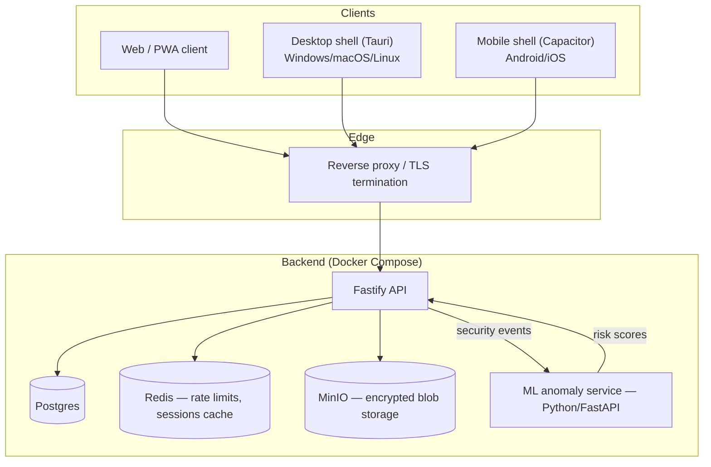
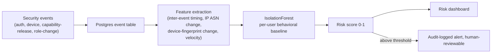

# PhantomVault — Architecture

Companion document to `THREAT_MODEL.md`. That document defines *what we defend against*; this one defines *how the system is built* to do it.

## 1. System overview



All three client shells (`web`, `desktop`, `mobile`) run the **same TypeScript application core** — one crypto implementation, one set of security-critical code paths, audited once instead of three times. Platform shells add native capabilities (OS keychain access, biometric unlock) without duplicating logic. This is the same pattern used by Bitwarden and Signal Desktop, and it is the only way a small team can honestly claim five-platform coverage without either shipping unaudited native crypto five times or lying about parity between platforms.

## 2. Monorepo layout

```
Cyber-security/
  docker-compose.yml          orchestrates postgres, redis, minio, api, ml-service, caddy
  docs/                       this document + THREAT_MODEL.md (source of truth)
  packages/
    crypto-core/               shared TS crypto — used by backend AND every client shell
  backend/
    src/
      auth/                    WebAuthn + TOTP + session/device management
      rbac/                    org/workspace/role model + authorization middleware
      capabilities/             capability-released content (§5.2)
      audit/                    hash-chained audit log
      security-events/          telemetry pipeline feeding ml-service
      routes/
    drizzle/                    SQL migrations
    test/                       vitest: unit + security regression tests
  ml-service/
    app/                        FastAPI + scikit-learn IsolationForest
    test/
  phantomvault/                 existing PWA client (being rewired to use packages/crypto-core
                                 and the backend instead of pure-local-only storage)
  .github/workflows/            CI: lint, typecheck, unit+regression tests, npm/pip audit,
                                 CodeQL, Semgrep, Trivy, Gitleaks, ZAP baseline (DAST)
```

## 3. Tech stack and rationale

| Layer | Choice | Why |
|---|---|---|
| Backend runtime | Node.js 22 + TypeScript, Fastify | Same language as the crypto core and clients — one team, one type system, shared validation schemas between client and server (fewer boundary bugs) |
| Database | Postgres 16 | Relational integrity for RBAC/org data and audit log ordering guarantees; battle-tested |
| Cache/rate-limit store | Redis 7 | Sub-millisecond token-bucket counters; standard choice, not reinvented |
| ORM/migrations | Drizzle | Type-safe, thin — raw SQL is visible where correctness (e.g. hash-chain inserts) matters |
| Object storage | MinIO (S3-compatible) | Self-hostable in Docker for dev/on-prem; same API as AWS S3/Cloudflare R2 for production swap-in |
| Auth (primary) | WebAuthn via `@simplewebauthn/server` + `/browser` | Phishing-resistant by construction; industry-standard library, not hand-rolled |
| Auth (MFA/fallback) | TOTP via `otplib` | RFC 6238, widely interoperable with authenticator apps |
| Tokens | `jose` (JWT) for short-lived access tokens; opaque DB-backed rows for refresh tokens | Access tokens are stateless and short-lived (5–15 min); refresh tokens are the actual revocation point — deleting a row instantly invalidates a session |
| Symmetric crypto | AES-256-GCM via Web Crypto API (browser) / Node `crypto` (backend), cross-checked with `@noble/ciphers` | Native, audited, no custom cipher code |
| Password-based KDF | PBKDF2-HMAC-SHA256 (client, 600k iter, browser WebCrypto support) / Argon2id (backend, via `argon2` native binding, for anything server-side) | PBKDF2 chosen client-side for universal WebCrypto support without WASM; Argon2id used server-side where a memory-hard KDF is straightforward to deploy |
| Public-key wrapping | X25519 + HKDF-SHA256 via `@noble/curves` / `@noble/hashes` | Audited pure-TS implementations, used in production by multiple wallet/security products |
| ML | Python 3.12, FastAPI, scikit-learn (`IsolationForest`) | A real unsupervised anomaly-detection algorithm operating on engineered numeric features — not an LLM call |
| Reverse proxy/TLS | Caddy | Automatic TLS, minimal config surface |
| Container orchestration | Docker Compose | Reproducible, self-hostable, no cloud account required to run the full stack locally |

## 4. Identity, sessions, and access control

### 4.1 Registration & login
1. **Primary:** WebAuthn passkey registration/authentication (`@simplewebauthn`). Server verifies attestation, stores the public key + signature counter, and checks the counter increases monotonically on each login (clone detection).
2. **MFA/fallback:** TOTP, required for any account action classified "sensitive" (role change, device revocation, capability revocation) regardless of primary auth method.
3. **Device registration:** each authenticated device gets a `devices` row (public key fingerprint, user agent, first-seen, last-seen). Users can list and revoke devices from Settings; revoking deletes the device's refresh tokens immediately.

### 4.2 Sessions
- Access token: JWT, 10-minute TTL, signed (ES256), carries `sub`, `org_id`, `role`, `device_id`.
- Refresh token: random 256-bit value, stored hashed in Postgres with `device_id`, `expires_at`, `revoked_at`. Rotated on every use (old value invalidated the moment a new one is issued) — limits the blast radius of a leaked refresh token to a single use.
- **Session revocation** = deleting/marking-revoked the refresh token row. Takes effect on the *next* refresh attempt; the already-issued access token remains valid for at most its 10-minute TTL, which bounds the worst case.

### 4.3 RBAC / organizations
- `organizations` → `org_members` (user_id, org_id, role) → `roles` define a small fixed set (`owner`, `admin`, `member`, `auditor`) with explicit permission sets, checked server-side on every request via middleware — the client's claimed role is never trusted, only the DB row is authoritative.
- `auditor` role exists specifically so a security team can be granted read-only access to the audit log and risk dashboard without touching content — a common real-world compliance requirement.

## 5. Cryptographic design

### 5.1 Symmetric primitive
AES-256-GCM everywhere a symmetric cipher is needed: content encryption, both capability envelope layers (§5.2), at-rest encryption of TOTP secrets and K_cap values. One primitive, one set of edge cases to get right, validated against NIST KAT vectors in `packages/crypto-core/test/vectors`.

### 5.2 Capability-released content — the double-envelope design

This is the mechanism that makes "server-enforced expiry/revocation" a real cryptographic property instead of a UI-level promise (the gap identified in the redesign requirements).

```mermaid
sequenceDiagram
    participant S as Sender client
    participant API as Backend API
    participant DB as Postgres
    participant R as Recipient client

    S->>S: generate CEK (random 256-bit)
    S->>S: ciphertext_inner = AES-256-GCM(content, CEK)
    S->>API: POST /capabilities {ciphertext_inner, policy}
    API->>API: generate K_cap (random 256-bit) — never sent to any client
    API->>API: ciphertext_outer = AES-256-GCM(ciphertext_inner, K_cap)
    API->>DB: store ciphertext_outer (blob) + K_cap + policy (expiresAt, maxOpens, revoked=false)
    API-->>S: capabilityId
    S->>R: capabilityId + CEK (out-of-band: share link, or told separately — sender's choice)

    R->>API: POST /capabilities/{id}/release  (authenticated)
    API->>API: check policy: not expired, not revoked, openCount < maxOpens
    alt policy allows
        API->>DB: openCount += 1; if maxOpens reached, revoked=true
        API-->>R: K_cap
        R->>R: ciphertext_inner = AES-256-GCM-decrypt(ciphertext_outer, K_cap)
        R->>R: content = AES-256-GCM-decrypt(ciphertext_inner, CEK)
    else policy denies
        API-->>R: 403, no key material returned
    end
```

**Why this achieves real server-side revocation:** the server never sees CEK or plaintext (zero-knowledge for content — TB-1/TB-2 hold), but it *does* generate and hold K_cap, the outer layer's key. Deleting or refusing to release K_cap makes `ciphertext_outer` permanently useless — even to someone holding both `ciphertext_outer` and CEK — because the inner ciphertext is unreachable without the outer layer being decrypted first. This is standard KMS-style envelope encryption, not a novel cryptographic construction; the only new engineering here is the policy/access-control protocol around K_cap release.

**Authorization model:** release is gated by *possessing* the capability ID (a random 122-bit UUID, effectively unguessable) plus being an authenticated PhantomVault account — not by an access-control list naming specific recipients. This is deliberate "capability-based security" in the formal sense (cf. capability URLs): the unguessable reference *is* the authorization. It means anyone the sender shares the ID with can call `/release` (subject to policy), which matches how the sender already controls distribution of that ID exactly as they control distribution of a share link today. A future ACL-scoped mode (bind a capability to specific recipient user IDs) is a straightforward extension, not implemented in this pass.

**Honest limit (repeated from the threat model because it matters):** this only prevents *future* releases. A recipient who has already called `/release` and decrypted the content has the plaintext; no cryptosystem revokes information from a human who has already seen it. "Capability Mode" is meaningfully stronger than the v1 device-local timer, not magic.

### 5.3 Offline Mode vs. Capability Mode
Both are kept, clearly labeled, because they serve different needs:
- **Offline Mode** — no server involved, works with plain pasted ciphertext (the v1 flow), device-local expiry/burn-after-reading only. Fully functional with zero infrastructure, zero accounts, zero metadata leakage to us. No server-side revocation is possible — this is stated as a property, not hidden.
- **Capability Mode** — requires the backend and an account; gains real server-enforced expiry/revocation/max-opens in exchange for that dependency.

### 5.4 At-rest secret encryption
TOTP secrets and K_cap values are encrypted at rest with a master key held outside the database (environment-provided in dev; a proper KMS/HSM in a production deployment — the Docker Compose dev setup documents this as a swap-in point, it does not pretend to provide HSM-grade protection itself).

### 5.5 Tamper-evident audit log
Each audit row stores `hash = SHA-256(prev_hash || canonical_json(event))`. Verifying the log means re-walking the chain and recomputing hashes — any historical edit breaks the chain from that point forward. This is the same idea as a blockchain or Certificate Transparency log, scoped down to a single appendonly Postgres table; no distributed consensus is needed because there's one writer (the API) and the guarantee we need is tamper-*evidence*, not tamper-*prevention* by a third party.

### 5.6 Key rotation
- User password/passphrase rotation (Offline Mode vaults): re-encrypts canary + every item under the new key (already implemented in v1, carried forward).
- Session keys: short TTL + rotation-on-refresh means there is no long-lived symmetric secret to "rotate" in the traditional sense.
- At-rest master key: documented rotation procedure (re-encrypt all K_cap/TOTP rows under a new master key) — operationally important, implemented as an admin-triggered maintenance job, not automatic (a full KMS would automate this; out of scope for the Docker Compose reference deployment).

## 6. Transport abstraction

See `THREAT_MODEL.md` §7 for the full design and rationale. Summary: `TransportAdapter` is an interface; `PhantomRelayAdapter` (server-backed, bit-perfect) and `ManualFileAdapter` (send the encrypted blob as an opaque file through any channel) are the recommended paths, `ConcealedImageAdapter` (LSB steganography) is retained only as an explicitly-labeled, opt-in, fragile concealment feature with a pre-send compatibility check.

## 7. Security event pipeline & ML anomaly detection



The model is trained per-user on that user's own historical event stream (classic UEBA framing: "is this unusual for *this* person," not for the population) — a global/cross-tenant model would leak behavioral patterns across organizational boundaries, which we treat as a privacy boundary. Scores inform a human-reviewable alert; they do not autonomously lock accounts, both because false positives in an unsupervised model are expected and because auto-lock is itself a DoS vector an adversary could trigger deliberately.

## 8. Deployment

`docker-compose.yml` at the repo root brings up the full stack (`postgres`, `redis`, `minio`, `api`, `ml-service`, `caddy`) with one command for local development or self-hosted production. Each service has a health check; the API waits on Postgres/Redis/MinIO readiness before accepting traffic. Production deployment swaps `minio` for S3/R2 and `postgres`/`redis` for managed equivalents by changing connection strings only — no application code changes.

## 9. Implementation status

This table is maintained as the project's honesty mechanism — nothing here is "done" until its row says so, regardless of how complete the surrounding code looks.

| Component | Status | Notes |
|---|---|---|
| Architecture & threat model | ✅ Done | This document + `THREAT_MODEL.md` |
| Shared crypto core + independent reference vectors | ✅ Done | `packages/crypto-core` — AES-256-GCM, PBKDF2, HKDF-SHA256, X25519 sealed box, double-envelope composition; 29 tests incl. Python-`cryptography`-generated cross-implementation vectors (2 of which independently match the published GCM spec test cases 13/14) + fuzz + tamper-detection |
| Docker Compose skeleton | ✅ Postgres/Redis/MinIO/Caddy running; `api` builds via Dockerfile | ML service container next |
| WebAuthn + TOTP auth | ✅ Done | Real FIDO2 emulator (nid-webauthn-emulator) end-to-end tests: register→login, challenge replay blocked, unregistered-credential rejected, origin-pinning verified independently of the emulator's own checks |
| Session/device revocation | ✅ Done | Refresh-token rotation with reuse-detection (revokes whole device on replay), device revocation, tested incl. concurrent-safety |
| RBAC / org model | ✅ Core done | owner/admin/member/auditor permission matrix + server-side enforcement, tested; org UI not built |
| Capability-released content (double envelope) | ✅ Done | Verified end-to-end over HTTP + regression tests: expiry, revocation (incl. after-first-release), max-opens with concurrent-race safety, ownership-gated revoke |
| Tamper-evident audit log | ✅ Done | Hash chain + DB trigger blocking UPDATE/DELETE (TRUNCATE/DDL by a privileged role is explicitly out of scope, documented in the migration), tamper-detection test, concurrency test |
| Rate limiting | ✅ Core done | Redis fixed-window + escalating auth lockout, tested; global `@fastify/rate-limit` wired into the server |
| Security event pipeline | ✅ Done | Feeds `security_events`; emitted on register/login/TOTP flows today |
| ML anomaly service | ✅ Done | Real scikit-learn `IsolationForest`, per-user behavioral baseline, feature engineering from allow-listed telemetry only; 15 tests incl. a live proof that an injected anomalous login (new device+ASN+country, odd hour, failed) scores above baseline |
| Transport abstraction (`TransportAdapter`) | ✅ Done | `phantomvault/src/lib/transport` — `ManualFileAdapter` (bit-perfect, always available), `PhantomRelayAdapter` (bit-perfect, backend-mediated, gated on being connected), `ConcealedImageAdapter` (fragile, opt-in, runs a **live** compatibility self-test — locally simulates JPEG recompression and re-attempts extraction before ever returning success). Verified against a real browser: the self-test correctly reports FAILED after simulated recompression, and all three adapters round-trip ciphertext byte-for-byte. Caught and fixed two real bugs in the process — see notes below. |
| Object storage for capability blobs | ✅ Done | Moved off inline-Postgres storage onto MinIO/S3 (`backend/src/lib/objectStorage.ts`); revoke/max-opens now delete the ciphertext blob itself, not just the K_cap gate (defense in depth), tested |
| Dockerized deployment | ✅ Done | 6-service Compose stack (postgres, redis, minio, api, ml-service, caddy) built and verified end-to-end, including cross-container networking (api → ml-service) |
| SAST/DAST/dependency/secret CI | ✅ Done | CodeQL (JS+Python), Semgrep, `npm audit` + `pip-audit`, Trivy container scan, Gitleaks, and a ZAP baseline DAST job against the live Compose stack — all in `.github/workflows/ci.yml`. ZAP runs report-only (`fail_action: false`) until findings are triaged. |
| Web client rewired to backend | ✅ Done | New `Connect` feature (WebAuthn passkey login/register via `@simplewebauthn/browser`) + `backendClient.ts`; Text Vault and File Locker each gained a Capability Mode alongside the original Offline Mode. WebAuthn wiring verified up to the point of the actual platform-authenticator ceremony (no authenticator available in the test environment — the ceremony logic itself is already covered by 45 backend tests against a real FIDO2 emulator). |
| Risk dashboard API | ✅ Backend proxy done | `GET /orgs/:id/risk-dashboard` → ml-service, RBAC-gated to `risk_dashboard:view`; no UI yet |
| Mobile shell (Capacitor) | 🟡 Partial | `npx cap init` + `npx cap add android` run for real — `phantomvault/android/` is genuine Capacitor-generated project structure, not hand-written. NOT built or run: this environment has no JDK/Android SDK, so compiling/launching it is unverified. iOS not attempted (needs a Mac). |
| Desktop shell (Tauri) | 🔲 Not attempted | This environment has no Rust/Cargo toolchain at all, and Tauri's config isn't meaningfully hand-writable without the CLI to validate it — attempting it here would mean shipping unverified guesses. Documented as a next step requiring `cargo install tauri-cli` on a machine that has Rust. |
| Enterprise admin console UI | 🔲 Not started | |

v1 (the existing `phantomvault/` PWA — local AES-256-GCM vault, duress mode, SOC log, B2B demo) remains a real, tested, honestly-labeled **Offline Mode** feature set throughout this build-out, not thrown away.

### 9.1 Bugs caught by live browser verification (not by any automated test)

Two real bugs surfaced only when the transport abstraction was driven end-to-end in an actual browser, illustrating why that step isn't optional even with a large automated suite:

1. **Adapter selection deadlock**: `ConcealedImageAdapter.isAvailable()` originally required a carrier image to already be set — but the carrier picker only renders *after* the adapter is selected, so the radio button could never be chosen. Fixed by separating "is this offered as a choice" from "does it have everything it needs to send right now" (the latter is validated at send time instead).
2. **Chrome-specific WebCrypto strictness**: `crypto.subtle.encrypt`/`decrypt` calls built their AES-GCM params object as `{ name, iv, additionalData: aad }` even when `aad` was `undefined`. Node's WebCrypto (and therefore every Vitest run, in both `packages/crypto-core` and the backend) tolerates an explicit `additionalData: undefined`; Chrome's does not, and throws `AeadParams: additionalData: Not a BufferSource`. Fixed in `packages/crypto-core/src/primitives.ts` by only including the key when AAD is actually provided — invisible to Node-based tests entirely, since jsdom's `crypto.subtle` also delegates to Node.
