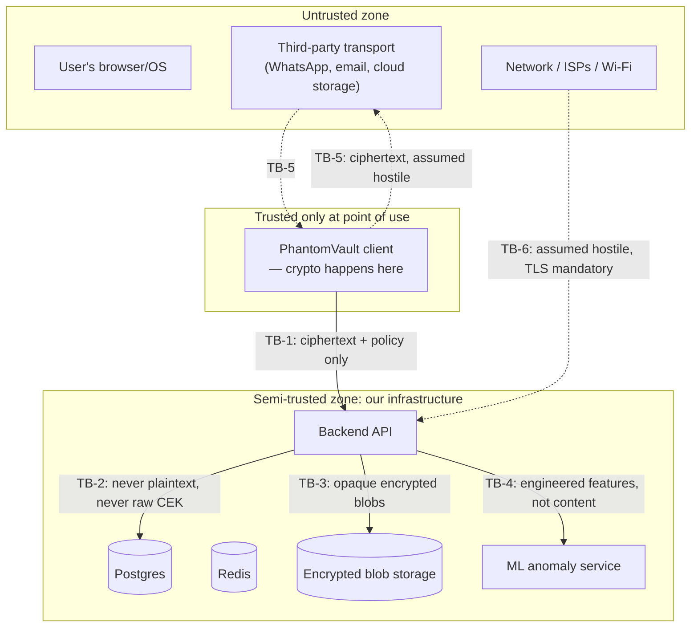
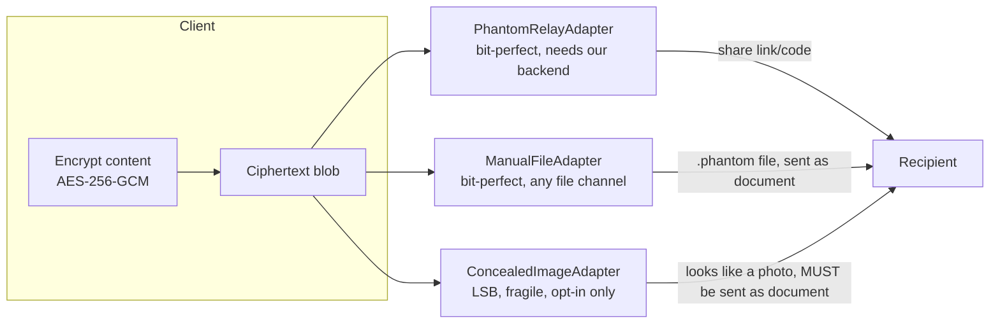

# PhantomVault — Threat Model

Methodology: STRIDE per component, PASTA-style adversary framing for the platform as a whole. This document is normative — implementation must satisfy it, and any deviation is a documented exception, not a silent gap.

## 1. Assets

| Asset | Description | Sensitivity |
|---|---|---|
| Plaintext content | Files/messages before encryption | Critical — must never exist server-side |
| Content Encryption Keys (CEKs) | Per-item AES-256 keys | Critical — must never exist server-side in usable form |
| Capability keys (K_cap) | Server-held outer-envelope keys gating access to stored ciphertext | High — server-side secret; its deletion is the security mechanism for revocation |
| WebAuthn credentials | Public keys + credential IDs | Medium — public by design, but binds identity |
| TOTP secrets | MFA seed | Critical — server-side, must be encrypted at rest |
| Session/refresh tokens | Bearer credentials for API access | High — theft = account takeover until revoked/expired |
| Audit log | Tamper-evident record of security events | High — integrity matters more than confidentiality |
| Org/RBAC data | Who can do what, in which workspace | High |
| ML telemetry (auth events, device fingerprints, access patterns) | Behavioral metadata | Medium — privacy-sensitive even though not "content" |

## 2. Trust boundaries

**Boundary definitions** (each is a place where a security property must be independently enforced, not inherited from the other side):

- **TB-1 (Client → API):** The client is the *only* place plaintext and raw CEKs may exist. Everything crossing this boundary is ciphertext, metadata, or policy. The backend's job is to never need — and structurally never receive — plaintext.
- **TB-2 (API → Database):** Even a fully compromised database dump must not yield plaintext content or usable CEKs. TOTP secrets and K_cap values are encrypted at rest with a KMS-held master key (see §5.4), not stored in cleartext columns.
- **TB-3 (API → Blob storage):** Blob storage holds only outer-enveloped ciphertext (§5.2). A compromised storage bucket yields nothing useful without K_cap from the database, and vice versa — this is deliberate: no single compromised store is sufficient.
- **TB-4 (API → ML service):** The ML service receives structured event *features* (timestamps, IP ASN, device fingerprint hash, action type, success/failure) — never file contents, message plaintext, or raw credentials.
- **TB-5 (Client ↔ third-party transport):** WhatsApp, email, cloud storage, USB drives — all are **assumed actively hostile**: they may log, recompress, scan, retain, or leak anything that passes through them. This is why encryption must complete before anything reaches this boundary, and why the transport abstraction (§7) treats "will this channel preserve my bytes" as a separate question from "is this encrypted."
- **TB-6 (Client/API ↔ network):** TLS 1.3 mandatory; the network is assumed hostile (passive and active MITM capability assumed for a nation-state-class adversary, though full defense against that tier is out of scope — see §3).

## 3. Adversary models

| Adversary | Capabilities assumed | In scope? |
|---|---|---|
| **A1 — Network attacker** | Passive/active MITM on TB-6, cannot break TLS 1.3 or the crypto primitives themselves | Yes — TLS + certificate pinning on native clients |
| **A2 — Malicious/compromised transport platform** (WhatsApp, email provider, cloud storage) | Full read/write/log access to anything sent through it | Yes — this is the entire premise of §7 |
| **A3 — Coercion/duress** (person forced to unlock under threat) | Physical access + can compel the legitimate user to authenticate | Yes — decoy vault (v1) + capability revocation model |
| **A4 — Malicious/curious server operator (us)** | Full access to DB, blob storage, logs, source code | Partially — zero-knowledge for content/CEKs (see §6 guarantees); operator *can* by design enforce policy (expiry/revocation) since that requires holding K_cap. This is a deliberate, documented tradeoff, not an oversight. |
| **A5 — Compromised client device** (malware, stolen unlocked device) | Full access to whatever the app can access while unlocked | Partially — non-extractable WebCrypto keys where possible, session-scoped secrets, but a compromised endpoint is close to game-over for any client-side security tool. Documented as an explicit non-goal to "solve." |
| **A6 — Credential stuffing / brute force** | Automated login attempts at scale | Yes — WebAuthn (phishing-resistant, no shared secret to stuff), rate limiting, account lockout with exponential backoff |
| **A7 — Insider with valid but narrow RBAC role** | Legitimate org access, attempting privilege escalation or data exfiltration beyond their role | Yes — RBAC enforcement, audit log, anomaly detection |
| **A8 — Nation-state-class adversary** (supply chain compromise, zero-days, legal compulsion of infrastructure provider) | Effectively unbounded | **Out of scope.** No consumer/prosumer security product can honestly claim this; stated explicitly so nobody mistakes silence for a guarantee. |

## 4. STRIDE per component

### 4.1 Authentication (WebAuthn + TOTP)
| Threat | Mitigation |
|---|---|
| **S**poofing — credential stuffing, phishing | WebAuthn is phishing-resistant by construction (origin-bound); TOTP as fallback/second factor, rate-limited |
| **T**ampering — replay of auth ceremony | WebAuthn challenge is single-use, server-generated, short TTL; signature counter checked to detect cloned authenticators |
| **R**epudiation — denying an auth event happened | Every auth attempt (success and failure) is audit-logged, hash-chained |
| **I**nfo disclosure — TOTP secret theft | Encrypted at rest (§5.4), never logged, never returned after initial setup |
| **D**oS — auth endpoint flooding | Redis-backed rate limiting per-IP and per-account, exponential backoff |
| **E**levation — session fixation, token forgery | Short-lived signed access tokens (JWT, `jose`), refresh tokens are opaque server-side rows (revocable), rotated on use |

### 4.2 Capability-released content (ephemeral messaging / file sharing)
| Threat | Mitigation |
|---|---|
| **S**poofing — forging a capability release request | Requester must present a valid session bound to the capability's authorized recipient policy |
| **T**ampering — modifying stored ciphertext | AES-GCM authenticated encryption at both envelope layers (§5.2); any modification fails the auth tag check, not silently corrupts |
| **R**epudiation — sender denies sending, recipient denies receiving | Audit log records capability creation and every release attempt (success/failure) with timestamps |
| **I**nfo disclosure — server operator reads content | Structurally prevented for content/CEK (server never holds them); explicitly *not* prevented for metadata (sender, recipient, size, timing) — documented in §6 |
| **D**oS — exhausting storage with junk uploads | Per-account quota, rate limiting on upload endpoint |
| **E**levation — releasing a capability after policy says no | Server-side policy check (expiry, max-opens, revoked flag) is the *sole* gate on returning K_cap; enforced in one code path, covered by regression tests (§9) |

### 4.3 Encrypted media / transport abstraction
| Threat | Mitigation |
|---|---|
| **T**ampering — transport (e.g. WhatsApp) recompresses/mutates bytes | Transport Compatibility Checker (§7.3) detects and warns *before* send, rather than silently failing after; `ManualFileAdapter`/`PhantomRelayAdapter` sidestep the problem structurally by never relying on pixel-level survival |
| **I**nfo disclosure — steganographic carrier reveals presence of hidden data via statistical analysis | Documented as a known limitation of LSB steganography generally (§7.4) — not claimed to defeat forensic steganalysis |

### 4.4 RBAC / organizations
| Threat | Mitigation |
|---|---|
| **E**levation — member acting outside their role | Server-side authorization check on every endpoint (never trust client-supplied role claims); deny-by-default |
| **R**epudiation — admin denies a permission change | Audit log entry on every role/permission mutation |

### 4.5 Audit log
| Threat | Mitigation |
|---|---|
| **T**ampering — retroactively editing/deleting log entries | Hash-chained log (§5.5): each entry commits to the hash of the previous entry; any edit breaks the chain from that point forward, detectable by a verification job |
| **R**epudiation — operator claims log is complete/accurate when it isn't | Chain verification is independently runnable and covered by a regression test that proves tampering is detected |

### 4.6 ML anomaly detection
| Threat | Mitigation |
|---|---|
| **I**nfo disclosure — feature data becomes a side channel for content | Feature extraction is allow-listed to specific numeric/categorical fields (§8); code-reviewed to never touch content or credential values |
| **D**oS / evasion — attacker shapes behavior to stay under the anomaly threshold | Acknowledged limitation of any statistical anomaly detector; mitigated by combining with hard rate limits (not ML-dependent) for the highest-severity abuse patterns |

## 5. Cryptographic design summary

(Full detail in `ARCHITECTURE.md` §5 — summarized here for threat-to-control traceability.)

- AES-256-GCM for all symmetric encryption (content, both envelope layers, at-rest secrets).
- PBKDF2-HMAC-SHA256 (600k iterations) or Argon2id (backend, where a memory-hard KDF is viable) for password-derived keys.
- X25519 + HKDF-SHA256 for public-key content wrapping where E2E-without-shared-secret is used.
- Ed25519/ES256/RS256 per WebAuthn's COSE algorithm negotiation (delegated to `@simplewebauthn`, not implemented by hand).
- All primitives from audited libraries (`@noble/*`, `libsodium-wrappers`, Node/Browser WebCrypto) — no custom cipher or KDF implementations anywhere in the codebase.

## 6. Security guarantees vs. explicit non-guarantees

This table exists because the previous prototype overstated what it delivered. It is the accountability mechanism for this redesign.

| Claim | Guaranteed? | Why |
|---|---|---|
| Server cannot read message/file plaintext | **Yes** | Structurally impossible — plaintext never crosses TB-1 |
| Server cannot recover a CEK once deleted | **Yes** | K_cap is generated server-side and only ever exists as ciphertext-gate, never derivable from stored data alone |
| Access to already-released content can be revoked | **No** (fundamental, not an implementation gap) | Once a recipient has decrypted content, no cryptosystem can force them to forget it. What *is* guaranteed: **future** releases can be blocked. |
| Metadata (who talked to whom, when, file sizes) is hidden from the server | **No** | Out of scope for this design; a full metadata-hiding system (e.g. Signal's sealed sender) is a documented roadmap item, not implemented |
| A message pasted into WhatsApp as ciphertext text is safe from server-side revocation | **No** | That flow is explicitly labeled "Offline Mode" — no server in the loop means no server-side revocation is possible, by definition. "Capability Mode" (requires connectivity) is the mode that provides this guarantee |
| Steganographic images survive social-media recompression | **No** | Never claimed as of this redesign; §7 explains why and what to use instead |
| The app defends against a compromised/malware-infected device | **No** | Explicit non-goal (A5); no client-side app can fully solve this |
| Nation-state-class adversaries are defended against | **No** | Explicit non-goal (A8) |

## 7. Transport abstraction for encrypted media

### 7.1 Principle
Encryption and transport are separate concerns with separate failure modes. Encryption failing means math is broken (should never happen with vetted libraries). Transport failing means *bytes changed in transit* — a mundane, near-guaranteed occurrence on platforms like WhatsApp that recompress "photo" uploads. Conflating the two — as the v1 prototype did by claiming steganography "works" without surfacing this — is the defect being corrected here.

### 7.2 `TransportAdapter` interface
Every adapter takes already-encrypted bytes (never plaintext) and is responsible only for getting them from sender to recipient intact, or failing loudly.

### 7.3 Transport Compatibility Checker
Before committing to `ConcealedImageAdapter`, the client runs a local self-test: re-encode the generated stego image at common lossy-recompression settings (JPEG q≈85, matching typical chat-app photo pipelines) and attempt extraction against the *simulated* result. If extraction fails locally, the UI blocks the "send as photo" path outright and steers the user to `ManualFileAdapter` or `PhantomRelayAdapter` instead of letting them discover the failure after the fact.

### 7.4 Known limitation of steganography (documented, not hidden)
LSB steganography does not resist statistical steganalysis (e.g., chi-square attacks on bit-plane distributions). It is retained only as an opt-in concealment feature for scenarios where hiding *that* content is encrypted matters more than transport robustness — not as a primary delivery mechanism.

## 8. ML anomaly detection — scope and data flow

Inputs are structured telemetry only: authentication outcome, timestamp, coarse geolocation (IP ASN/country, not precise GPS), device fingerprint hash, action type (login, device-add, capability-release, role-change), and derived behavioral features (inter-event timing, request velocity). No file contents, message plaintext, or raw credentials are ever features. The model (isolation forest over per-user behavioral baselines — see `ARCHITECTURE.md` §8 for the full pipeline) outputs a bounded risk score consumed by the security dashboard and, above a threshold, by an alerting rule — it does not autonomously lock accounts (avoiding a new DoS vector from adversarial false positives) without a human-reviewable audit trail.

## 9. Test strategy (threat → test traceability)

| Threat class | Test type | Example |
|---|---|---|
| Crypto correctness | Known-answer tests against NIST/RFC test vectors | AES-256-GCM KAT vectors, PBKDF2 RFC 6070 vectors |
| Crypto robustness | Property-based/fuzz tests | Random plaintext/password round-trips; tamper-one-byte must always fail auth |
| Capability revocation | Security regression tests | Expired/revoked/max-opens capability must return 403 with zero content leakage, asserted directly against the release endpoint |
| Audit log integrity | Tamper-detection test | Mutate one historical row directly in the DB, assert the chain verifier flags it |
| AuthN/AuthZ | Negative tests per RBAC role | Every endpoint tested with an under-privileged token, must be denied |
| Rate limiting | Abuse-simulation test | N+1 rapid requests from one identity must be throttled |
| Dependency/supply chain | `npm audit` / `pip-audit`, Dependabot | CI-gated |
| Static analysis | Semgrep + CodeQL | CI-gated |
| Dynamic analysis | OWASP ZAP baseline scan against the running Docker stack | CI-gated, non-blocking initially (report-only) until triaged |
| Container hygiene | Trivy image scan | CI-gated |
| Secret leakage | Gitleaks | CI-gated on every push |

Every row above must have a corresponding automated test before a feature is marked "production" in this repo's status tracking — matching the standing instruction not to label prototype behavior as production-secure.
